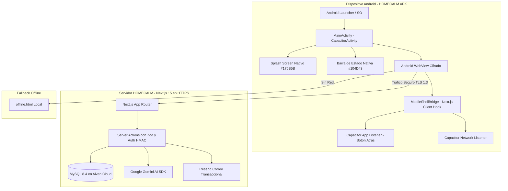

# ARQUITECTURA ANDROID DE HOMECALM

## 1. Visión General

HOMECALM para Android es una aplicación móvil nativa desarrollada bajo el patrón **Server-Driven Native Shell** mediante **Capacitor 8**, integrada directamente con el ecosistema de **Next.js 15 (App Router)**, **React 19**, **TypeScript** y **Tailwind CSS 4**.

Esta arquitectura permite combinar la agilidad, reactividad y capacidades completas de Next.js Server Actions en la nube con la experiencia de usuario, ciclo de vida, barra de estado, pantalla de bienvenida (*splash screen*) y manejo de eventos de hardware propios de un dispositivo Android.

---

## 2. Decisión Arquitectónica: ¿Por qué Server-Driven Hybrid y no Export Estático o React Native?

### 2.1 Incompatibilidad del Export Estático (`output: 'export'`)
HOMECALM implementa una arquitectura segura y moderna donde:
1. Las operaciones críticas de base de datos se ejecutan en el servidor mediante **Next.js Server Actions** (`"use server"`).
2. Las sesiones se autentican mediante **cookies HTTP seguras con firma HMAC-SHA256**.
3. La base de datos MySQL (Aiven Cloud), la API de Inteligencia Artificial (Google Gemini) y el servicio de correos transaccionales (Resend) **nunca deben exponer sus credenciales en el cliente móvil**.

Un empaquetado puramente estático (`next export`) rompería de inmediato los Server Actions, las rutas dinámicas y forzaría a conectar la base de datos directamente desde el dispositivo cliente, lo que representaría una **vulnerabilidad crítica de seguridad**.

### 2.2 Descarte de Reescritura en React Native
Una reescritura en React Native implicaría desechar los más de 17 módulos completamente desarrollados y probados (Fases 1 a 4), reconstruir cientos de componentes UI y duplicar la lógica de negocio.

### 2.3 Solución Implementada: Shell Nativo Híbrido Seguro
Capacitor envuelve la aplicación en una instancia optimizada de Android WebView (Android System WebView / Chrome Custom Engine) configurada con:
- Cifrado forzado de tráfico HTTPS (`https://homecalm.app`).
- Políticas de seguridad CSP y HSTS activas.
- Comunicación bidireccional mediante el puente nativo de Capacitor.
- Manejo nativo de desconexión mediante pantalla de contingencia offline (`public/offline.html`).



---

## 3. Identidad Visual y Configuración de Marca

La aplicación Android refleja la identidad corporativa de HOMECALM:

| Atributo | Valor | Descripción |
| :--- | :--- | :--- |
| **Nombre de la App** | `HOMECALM` | Nombre comercial visible en el launcher y barra de tareas de Android. |
| **Identificador de Paquete (Application ID)** | `com.homecalm.app` | Identificador único en Android y Google Play Store. |
| **Color Primario (Tema)** | `#176B5B` | Color principal de acento, interfaz y splash screen. |
| **Color de Barra de Estado** | `#104D43` | Verde profundo con iconos claros (`DARK style`). |
| **Color de Fondo** | `#176B5B` | Evita parpadeos blancos durante el arranque en frío. |
| **Ícono de Lanzador** | `ic_launcher` / Adaptativo | Logotipo de HOMECALM adaptado a resoluciones mdpi, hdpi, xhdpi, xxhdpi y xxxhdpi. |

---

## 4. Puente Nativo: `MobileShellBridge`

El componente [`src/components/mobile-shell-bridge.tsx`](file:///c:/Users/svillada/homeflow-source/homeflow/src/components/mobile-shell-bridge.tsx) se monta en el [`src/app/layout.tsx`](file:///c:/Users/svillada/homeflow-source/homeflow/src/app/layout.tsx) y gestiona de manera transparente:

1. **Detección Condicional**: Solo activa los plugins de Capacitor si detecta un entorno nativo (`Capacitor.isNativePlatform()`). En navegadores web tradicionales (Chrome, Safari, Firefox) degrada suavemente sin generar advertencias ni errores.
2. **Control de Splash Screen**: Transición suave desvaneciendo la pantalla de carga tan pronto como la aplicación React termina su ciclo inicial de hidratación.
3. **Manejo del Botón Físico de Atrás**: Escucha el evento `backButton` de Android. Si el usuario tiene historial de navegación (`window.history.length > 1`), retrocede a la pantalla previa; si se encuentra en la pantalla principal, minimiza o cierra la aplicación ordenadamente sin dejar procesos colgados.
4. **Control de Barra de Estado**: Garantiza contraste accesible y sincronización cromática con las cabeceras de los módulos de la aplicación.

---

## 5. Seguridad Móvil y Permisos

El archivo `AndroidManifest.xml` se configuró siguiendo el principio de mínimos privilegios:

```xml
<manifest xmlns:android="http://schemas.android.com/apk/res/android">
    <!-- Unico permiso requerido para la comunicacion segura con el servidor -->
    <uses-permission android:name="android.permission.INTERNET" />
    <uses-permission android:name="android.permission.ACCESS_NETWORK_STATE" />
    ...
</manifest>
```

### Directrices de Seguridad Auditadas:
1. **Sin Almacenamiento de Secretos**: El archivo APK **no contiene** claves de API de Gemini, contraseñas de MySQL, tokens de Resend ni variables secretas de sesión.
2. **Cifrado en Tránsito**: Solo se permiten conexiones seguras HTTPS. `cleartextTraffic` está explícitamente deshabilitado para producción.
3. **Firmado Criptográfico**: Las compilaciones Release se firman mediante llaves RSA de 2048 bits con algoritmo `SHA256withRSA`.

