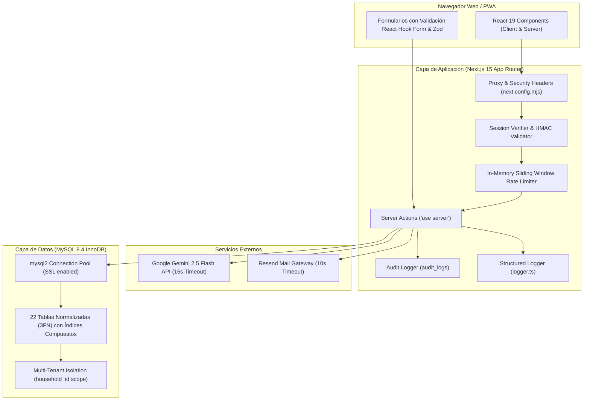
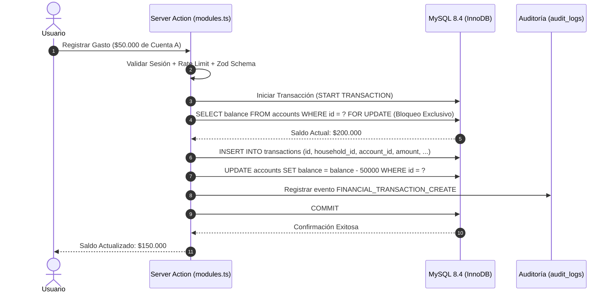

# ARQUITECTURA DEL SISTEMA – HOMECALM

## 1. Diagrama de Arquitectura de Capas

---

## 2. Modelo de Aislamiento Multi-Inquilino (Multi-Tenancy)

HOMECALM implementa un modelo de **Aislamiento Lógico por Household**:
1. Toda entidad operativa (`accounts`, `transactions`, `budgets`, `tasks`, `events`, `inventory`, `shopping_lists`, `debts`, `savings_goals`, `weekly_meal_plans`, `chat_conversations`, `audit_logs`) contiene una clave foránea obligatoria `household_id`.
2. Los usuarios se asocian a los hogares mediante la tabla `household_members`, que define su rol (`admin` o `member`).
3. En la capa de Server Actions, **nunca** se acepta el `household_id` desde el payload del cliente. El `household_id` se extrae exclusivamente de la cookie de sesión firmada criptográficamente con HMAC-SHA256.
4. Cada consulta de lectura y escritura incorpora de forma obligatoria e inmutable el filtro `WHERE household_id = ?`, haciendo imposible el acceso cruzado entre hogares distintos.

---

## 3. Modelo de Control de Acceso Basado en Roles (RBAC)

| Rol | Alcance de Permisos | Restricciones |
|---|---|---|
| **Admin** | Control total del hogar: finanzas, miembros, presupuestos, configuración global del hogar y eliminación de cuentas. | Sujeto a rate limiting en acciones sensibles y registro obligatorio en `audit_logs`. |
| **Member** | Lectura y gestión colaborativa de tareas, compras, eventos, inventario, visualización y registro de transacciones. | Bloqueado para renombrar el hogar, cambiar moneda base, eliminar cuentas bancarias o expulsar miembros. |

---

## 4. Flujo de Datos Financieros con Bloqueo de Fila

