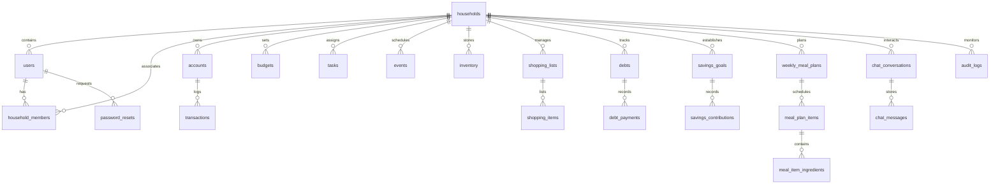

# DICCIONARIO Y MODELO DE BASE DE DATOS – HOMECALM

## 1. Motor y Características
- **Motor:** MySQL 8.4.11 / InnoDB.
- **Juego de Caracteres:** `utf8mb4` con cotejamiento `utf8mb4_unicode_ci`.
- **Integridad:** Claves foráneas con eliminación en cascada (`ON DELETE CASCADE`) para dependencias hijas (ej. `debt_payments`, `savings_contributions`, `shopping_items`, `meal_item_ingredients`, `chat_messages`).

---

## 2. Diagrama Entidad-Relación (ERD)

---

## 3. Catálogo de Tablas (22 Tablas)

1. **`households`**: Núcleo del inquilino (nombre, moneda base, paso de onboarding, estado de completitud).
2. **`users`**: Identidad de usuario (nombre, correo único, contraseña hasheada bcrypt, timestamp de cambio de contraseña).
3. **`household_members`**: Asociación de usuarios a hogares con roles (`admin`, `member`).
4. **`accounts`**: Cuentas financieras (bancos, efectivo, billeteras digitales, tarjetas de crédito) con saldo persistente.
5. **`transactions`**: Movimientos financieros clasificados como `income` o `expense`.
6. **`budgets`**: Presupuestos mensuales por categoría con límites y control de gasto real.
7. **`tasks`**: Tareas domésticas con responsable asignado, prioridad (`low`, `medium`, `high`) y fecha límite `DATE`.
8. **`events`**: Eventos y reuniones del hogar con fecha `DATE` y presupuesto asociado.
9. **`inventory`**: Artículos de despensa y suministros con cantidad, ubicación y fecha de caducidad `DATE`.
10. **`shopping_lists`**: Listas maestras de compras del hogar.
11. **`shopping_items`**: Artículos individuales de la lista de compras con cantidad, categoría y estado de adquisición.
12. **`debts`**: Registro de pasivos y deudas externas con acreedor, monto total, saldo restante y fecha límite.
13. **`debt_payments`**: Historial auditable de abonos y pagos realizados a cada deuda.
14. **`savings_goals`**: Metas de ahorro con monto objetivo, acumulado actual y fecha proyectada `DATE`.
15. **`savings_contributions`**: Historial de depósitos y aportes realizados a cada meta de ahorro.
16. **`weekly_meal_plans`**: Planes de alimentación estructurados por semana (`start_date` normalizada).
17. **`meal_plan_items`**: Platos planificados por día de la semana (`day_of_week`) y tiempo de comida (`meal_type`).
18. **`meal_item_ingredients`**: Ingredientes necesarios para cada plato con cantidad y unidad de medida.
19. **`chat_conversations`**: Hilos de conversación del asistente IA por hogar.
20. **`chat_messages`**: Mensajes intercambiados con el asistente IA (`user`, `assistant`, `system`).
21. **`password_resets`**: Tokens criptográficos SHA-256 para restablecimiento seguro de claves con expiración horaria.
22. **`audit_logs`**: Bitácora inmutable de eventos sensibles del sistema con IP, usuario y detalles enmascarados.

---

## 4. Índices Compuestos de Producción (Optimizaciones Fase 4)

| Tabla | Nombre del Índice | Columnas Indexadas | Propósito de Rendimiento |
|---|---|---|---|
| `transactions` | `idx_tx_hh_date` | `(household_id, date)` | Aceleración de filtros cronológicos en dashboard y finanzas. |
| `transactions` | `idx_tx_hh_cat_date` | `(household_id, category, date)` | Agrupación instantánea de gastos por categorías y cálculo de presupuestos. |
| `tasks` | `idx_tasks_hh_done_due` | `(household_id, completed, due_date)` | Consulta de tareas pendientes ordenadas por urgencia sin table scan. |
| `events` | `idx_events_hh_date` | `(household_id, event_date)` | Agenda y calendario de eventos próximos. |
| `inventory` | `idx_inventory_hh_expires` | `(household_id, expires)` | Alertas de vencimiento de alimentos en despensa. |
| `shopping_items` | `idx_shop_items_list_purchased` | `(shopping_list_id, purchased)` | Filtrado de artículos pendientes de compra en tiempo real. |
| `chat_messages` | `idx_chat_msg_conv_created` | `(conversation_id, created_at)` | Recuperación rápida del historial de conversación para inyección a la IA. |
| `meal_plan_items` | `idx_meal_items_plan_day` | `(plan_id, day_of_week)` | Renderizado ágil de la grilla semanal de alimentación. |

